<div align="center">

# দোকান হিসাব (Dokan Hisab)

**ছোট দোকানদারদের জন্য সম্পূর্ণ বাংলা, ফ্রি ও অফলাইন আয়-ব্যয় এবং বাকি-দেনার হিসাবের অ্যাপ**

*A free, offline-first, Bengali-only income/expense and credit (baki) tracker for small shop owners.*


<br />

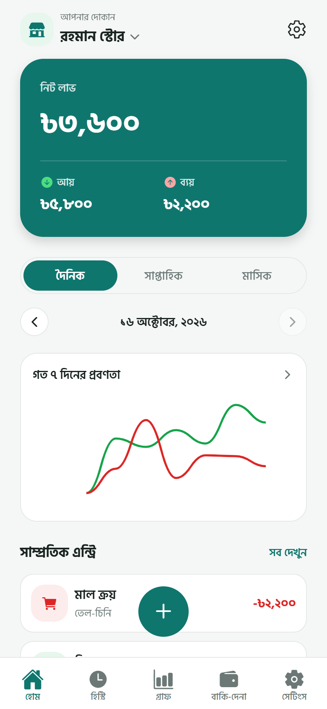
&nbsp;
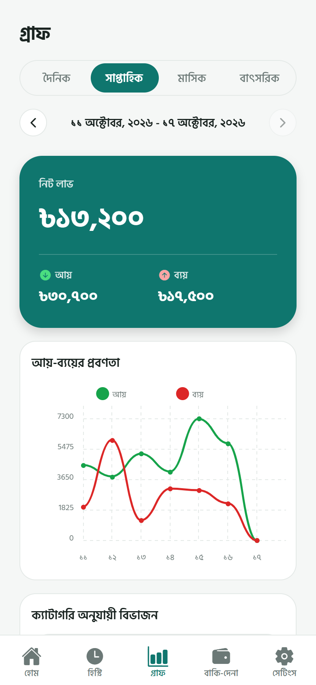
&nbsp;
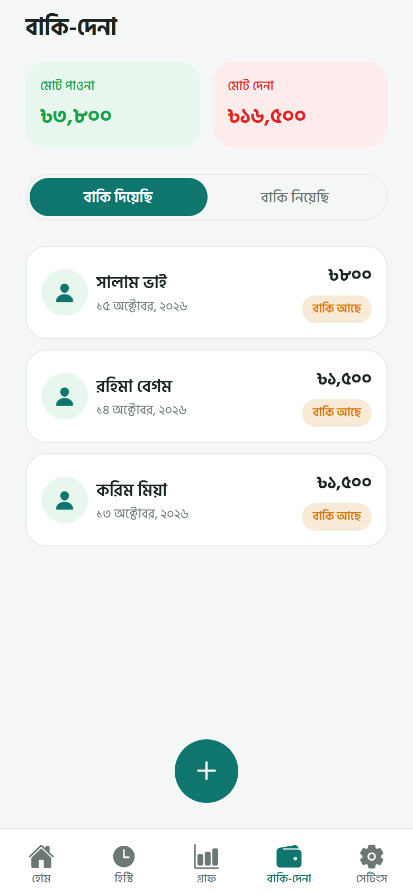

</div>

---

## ডাউনলোড

<div align="center">

<a href="https://github.com/rehadhasan/Dokan-Hisab/releases/latest/download/dokan-hisab.apk"></a>
&nbsp;
<a href="https://github.com/rehadhasan/Dokan-Hisab/releases"></a>

</div>

- APK ডাউনলোড করে ফোনে ইনস্টল করুন। ইনস্টলের সময় ফোন "Install unknown apps" অনুমতি চাইতে পারে — অনুমতি দিন।
- ইন্টারনেট ছাড়াই পুরো অ্যাপ কাজ করে। সব ডেটা আপনার ফোনেই থাকে, কোনো সার্ভারে যায় না।
- iOS-এর জন্য এখনো সরাসরি ডাউনলোড নেই। সোর্স থেকে চালাতে নিচের [ডেভেলপারদের জন্য](#ডেভেলপারদের-জন্য) অংশ দেখুন।

---

## ফিচার

**দৈনিক আয়-ব্যয়ের হিসাব**
- এক ট্যাপে নতুন এন্ট্রি: আয় বা ব্যয়, পরিমাণ, ক্যাটাগরি, তারিখ ও নোট
- যেকোনো এন্ট্রি এডিট বা ডিলিট করা যায়

**হোম ড্যাশবোর্ড**
- আজকের মোট আয়, মোট ব্যয় ও নিট লাভ/ক্ষতি, সংখ্যা বাড়ার অ্যানিমেশনসহ
- দৈনিক / সাপ্তাহিক / মাসিক ভিউ, আগের-পরের সময়ে যাওয়ার তীর
- গত ৭ দিনের আয়-ব্যয়ের ট্রেন্ড ও সাম্প্রতিক এন্ট্রি

**হিস্ট্রি**
- তারিখ অনুযায়ী সাজানো এন্ট্রি, প্রতিদিনের নিট হিসাবসহ
- নোট বা ক্যাটাগরি দিয়ে সার্চ, আয়/ব্যয়/ক্যাটাগরি ফিল্টার
- সোয়াইপ করে এডিট বা ডিলিট

**গ্রাফ**
- দৈনিক / সাপ্তাহিক / মাসিক / বাৎসরিক আয়-ব্যয়ের ট্রেন্ড চার্ট
- ক্যাটাগরি অনুযায়ী পাই চার্ট এবং সবচেয়ে বেশি খরচের র‍্যাঙ্কিং

**বাকি-দেনা**
- "বাকি দিয়েছি" (পাওনা) ও "বাকি নিয়েছি" (দেনা) আলাদা ট্যাবে
- মোট পাওনা ও মোট দেনার সামারি
- আংশিক পরিশোধ যোগ করা যায়, পুরো শোধ হলে স্ট্যাটাস নিজে থেকে "পরিশোধ হয়েছে" হয়ে যায়

**ক্যাটাগরি**
- আগে থেকে দেওয়া ক্যাটাগরি (বিক্রয়, মাল ক্রয়, দোকান ভাড়া, বিদ্যুৎ বিল, পরিবহন, বেতন ইত্যাদি)
- নিজের ক্যাটাগরি যোগ, এডিট ও ডিলিট, আইকন বেছে নেওয়ার সুবিধাসহ

**একাধিক দোকান**
- একাধিক দোকান যোগ করা যায়, প্রতিটির হিসাব আলাদা
- হোম স্ক্রিন থেকে এক ট্যাপে দোকান বদলানো যায়

**ব্যাকআপ ও এক্সপোর্ট**
- এন্ট্রি CSV বা PDF ফাইল হিসেবে এক্সপোর্ট করে WhatsApp, ইমেইল ইত্যাদিতে শেয়ার
- সব দোকানের সম্পূর্ণ ডেটার ব্যাকআপ ফাইল তৈরি এবং নতুন ফোনে রিস্টোর

**আরও**
- লাইট ও ডার্ক থিম
- সংখ্যা বাংলা (১২৩) অথবা ইংরেজি (123) — সেটিংস থেকে বেছে নেওয়া যায়
- বাংলা ফন্ট (Hind Siliguri), বড় বাটন ও পরিষ্কার ডিজাইন
- বাটনে ট্যাপ ও সেভ/ডিলিটে হালকা ভাইব্রেশন
- ঐচ্ছিক ডেভেলপার সাপোর্ট: বিকাশ/নগদে ডোনেট, কোনো জোর নেই

---

## স্ক্রিনশট

<table>
  <tr>
    <td align="center">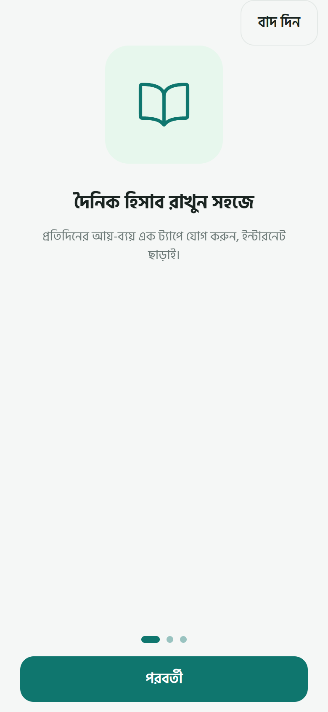<br /><b>অনবোর্ডিং</b></td>
    <td align="center">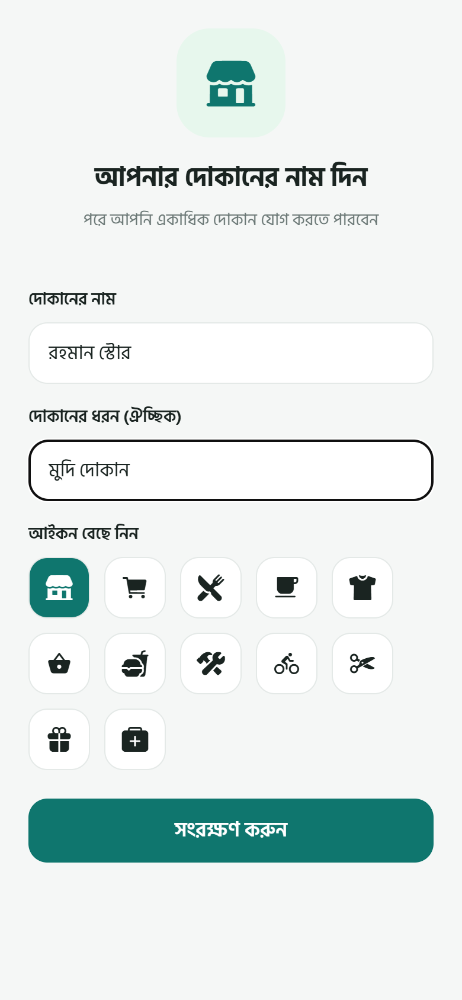<br /><b>দোকান তৈরি</b></td>
    <td align="center"><br /><b>হোম ড্যাশবোর্ড</b></td>
    <td align="center">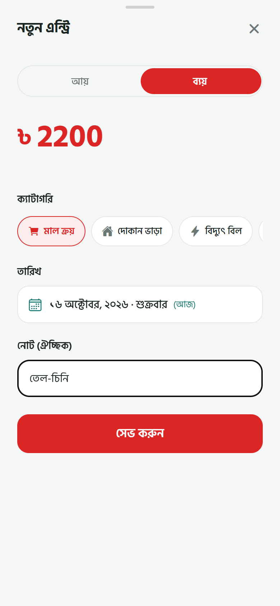<br /><b>নতুন এন্ট্রি</b></td>
  </tr>
  <tr>
    <td align="center">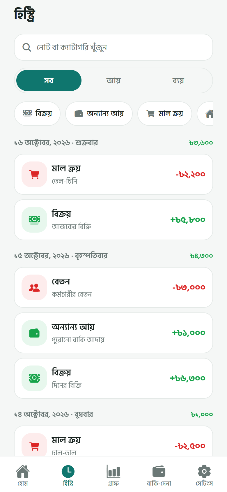<br /><b>হিস্ট্রি</b></td>
    <td align="center"><br /><b>আয়-ব্যয়ের গ্রাফ</b></td>
    <td align="center">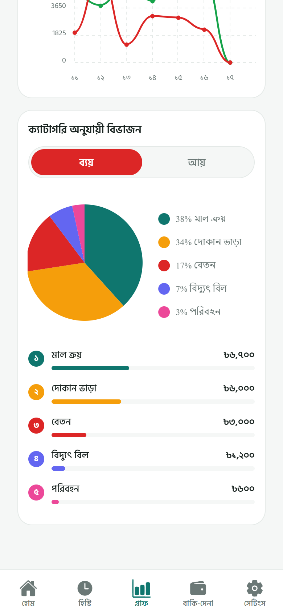<br /><b>ক্যাটাগরি অনুযায়ী খরচ</b></td>
    <td align="center"><br /><b>বাকি-দেনা</b></td>
  </tr>
  <tr>
    <td align="center">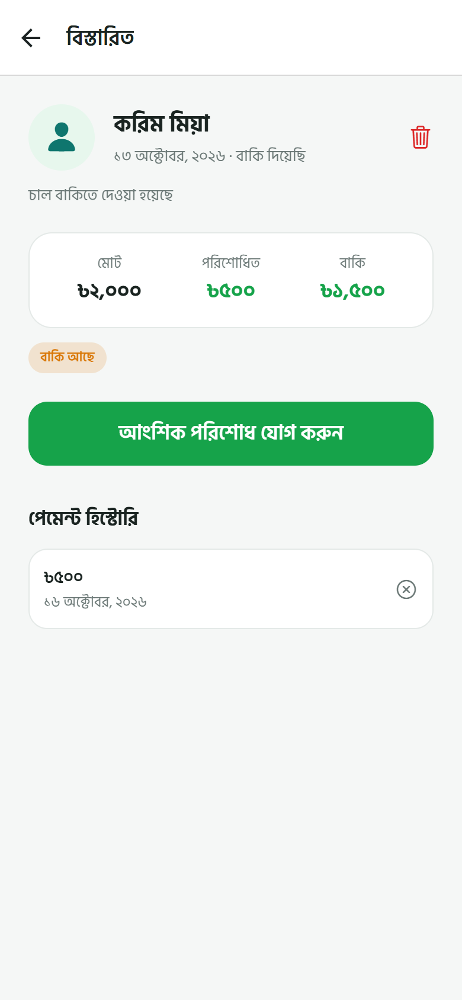<br /><b>আংশিক পরিশোধ</b></td>
    <td align="center">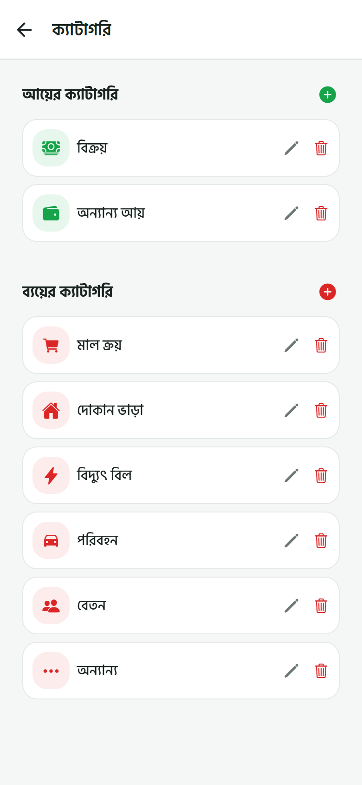<br /><b>ক্যাটাগরি</b></td>
    <td align="center">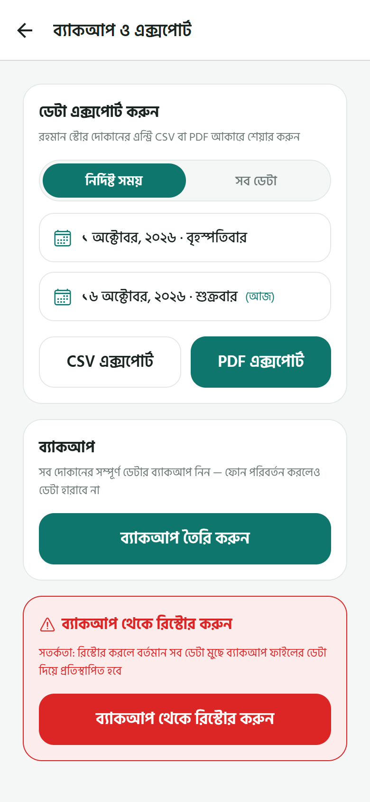<br /><b>ব্যাকআপ ও এক্সপোর্ট</b></td>
    <td align="center">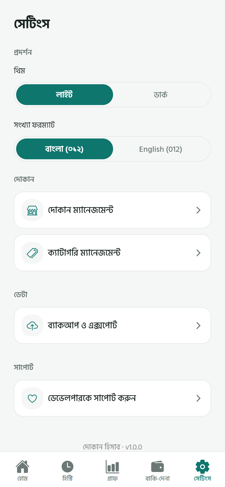<br /><b>সেটিংস</b></td>
  </tr>
  <tr>
    <td align="center">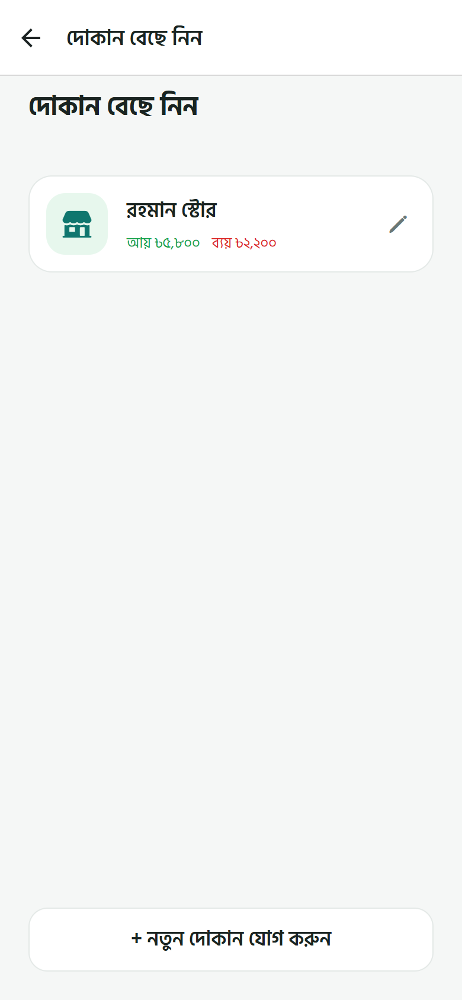<br /><b>দোকান বেছে নিন</b></td>
    <td align="center">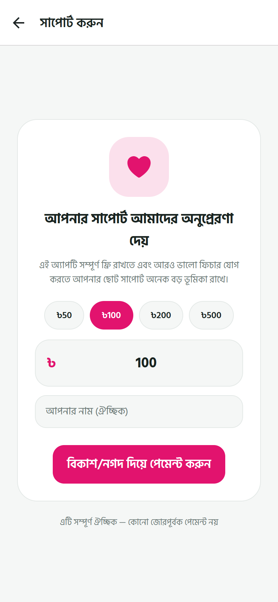<br /><b>সাপোর্ট (ঐচ্ছিক)</b></td>
    <td align="center">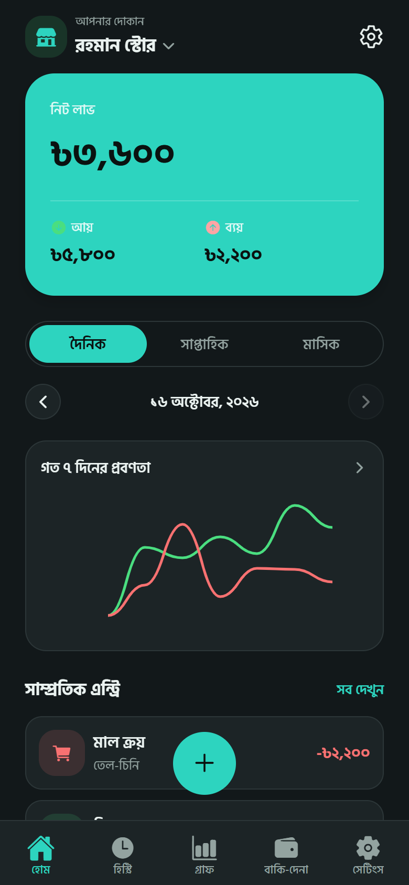<br /><b>ডার্ক থিম</b></td>
    <td align="center">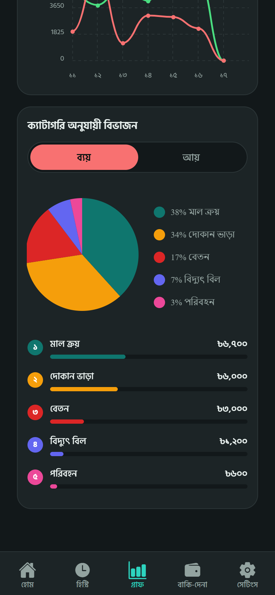<br /><b>ডার্ক থিম গ্রাফ</b></td>
  </tr>
</table>

---

## প্রযুক্তি

| বিষয় | ব্যবহৃত টুল |
| --- | --- |
| Framework | React Native 0.86, Expo SDK 57, TypeScript |
| ডেটাবেস | `expo-sqlite` (সব ডেটা ফোনে, কোনো backend নেই) |
| State | Zustand |
| Navigation | React Navigation (native stack + bottom tabs) |
| চার্ট | `react-native-chart-kit`, `react-native-svg` |
| অ্যানিমেশন | `react-native-reanimated`, `expo-haptics` |
| এক্সপোর্ট/ব্যাকআপ | `expo-file-system`, `expo-print`, `expo-sharing`, `expo-document-picker` |
| ফন্ট | Hind Siliguri |
| ডোনেশন পেমেন্ট | UddoktaPay/Paymently API + `react-native-webview` |

---

## ডেভেলপারদের জন্য

### প্রজেক্ট চালানো

```bash
git clone https://github.com/rehadhasan/Dokan-Hisab.git
cd Dokan-Hisab
npm install
npx expo start
```

এরপর QR কোড স্ক্যান করে ফোনে Expo Go দিয়ে খুলুন, অথবা `a` চেপে Android emulator-এ চালান।

ব্রাউজারে দেখতে চাইলে `npx expo start --web` চালানো যায়। তবে ওয়েবে ফাইল এক্সপোর্ট/ব্যাকআপ, তারিখ পিকার ও হ্যাপটিক কাজ করে না — এগুলো ফোনে পরীক্ষা করুন।

### ডোনেট (পেমেন্ট) সেটআপ — ঐচ্ছিক

প্রজেক্টের রুটে একটি `.env` ফাইল বানান (এটি `.gitignore`-এ আছে, কমিট হবে না):

```env
EXPO_PUBLIC_UDDOKTAPAY_BASE_URL=https://your-panel.example.com/api
EXPO_PUBLIC_UDDOKTAPAY_API_KEY=your-api-key
```

`.env` না থাকলে UddoktaPay-এর পাবলিক sandbox ব্যবহার হয়, যেখানে আসল কোনো টাকা কাটে না।

> `EXPO_PUBLIC_*` ভ্যালু অ্যাপের বান্ডলের ভেতরে ঢুকে যায়, তাই যে কেউ অ্যাপ ঘাঁটলে এই key দেখতে পারবে। বড় পরিসরে ব্যবহারের আগে পেমেন্ট কল একটি ছোট backend-এর মাধ্যমে করা উচিত।

### APK বানানো

```bash
npx eas-cli@latest login
npx eas-cli@latest build:configure
npx eas-cli@latest build --platform android --profile preview
```

বিল্ড শেষে APK ফাইলটির নাম `dokan-hisab.apk` করে GitHub **Releases**-এ আপলোড করলে উপরের ডাউনলোড বাটন সরাসরি কাজ করবে। প্রথমবার বিল্ডের আগে `app.json`-এ `android.package` (যেমন `com.yourname.dokanhisab`) ঠিক করে নিতে হবে।

### ফোল্ডার কাঠামো

```
src/
  components/   পুনর্ব্যবহারযোগ্য UI (বাটন, কার্ড, চার্ট, টগল ইত্যাদি)
  db/           SQLite স্কিমা, repository, ব্যাকআপ/রিস্টোর
  navigation/   রুট স্ট্যাক ও বটম ট্যাব
  screens/      সব স্ক্রিন
  services/     পেমেন্ট API ক্লায়েন্ট
  store/        Zustand store
  theme/        রঙ, ফন্ট, লাইট/ডার্ক থিম
  utils/        তারিখ, সংখ্যা ফরম্যাট, এক্সপোর্ট হেল্পার
docs/screenshots/   README-এর স্ক্রিনশট
```

---

## লাইসেন্স

MIT — বিস্তারিত [LICENSE](LICENSE) ফাইলে।
